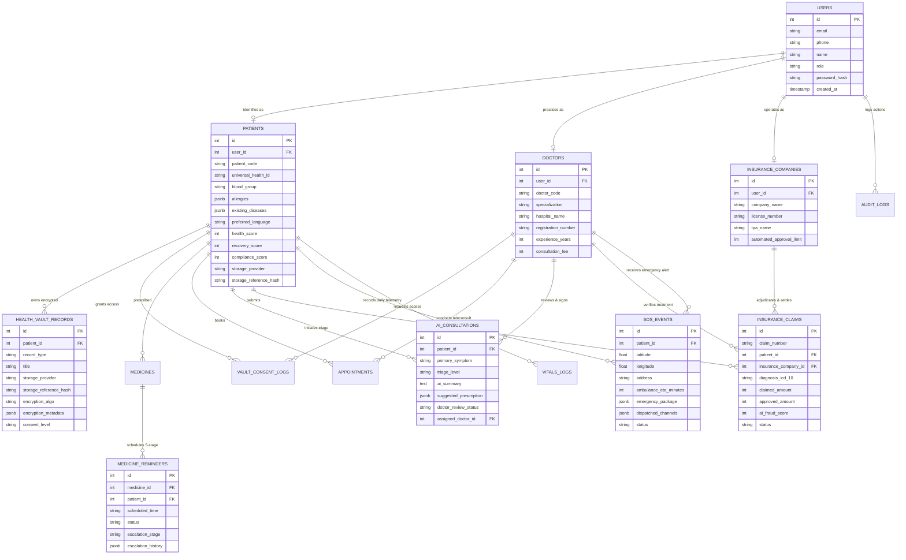

# Medisense AI - Entity-Relationship (ER) Architecture

## Architectural Design Highlights

1. **Self-Sovereign Health Vault**: The platform only stores encryption metadata and decentralized access pointers (Google Drive, OneDrive, iCloud, Local Device Storage). Patient holds private cryptographic authority.
2. **5-Stage Escalation Ladder**: Push Notification → First SMS → Urgent Second SMS → AI Voice Call → Interactive IVRS → Doctor & Family Escalation with automated compliance penalty.
3. **AI Consultation Loop**: AI collects symptoms, ingests vault medical history, flags red flags, formulates ICD-10 diagnosis & suggested Rx, and queues it directly in the Doctor Portal for 1-click clinical sign-off.
4. **4-Stage Claims Automation**: Claim Submission → AI Medical Necessity & Fraud Validation → Doctor Verification → Instant Settlement Payout.
5. **Real-Time SOS Broadcast**: Single-tap alert dispatches patient blood group, allergies, active meds, and live GPS location to Doctor, Hospital ER, Insurer, and Top 3 Family Members across SMS, Push, Email, and IVRS.
